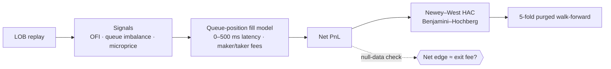

<div align="center">


# Siddhardha Devarakonda

### Causal Decision-Making · Offline RL · Quantitative Finance · Systems Engineering

*Building models and tools that make reliable decisions when data is confounded, non-stationary, and only partly observed, and testing every signal before trusting it.*


[LinkedIn](https://www.linkedin.com/in/siddhardhadeverakonda) · [Email](mailto:siddhardhdevarakonda17@gmail.com) · [GitHub](https://github.com/siddhardhad17)

</div>

---

## 👋 About

Quantitative researcher and systems engineer working where **C++ derivatives pricing**, **limit-order-book (LOB) simulation**, and **causal world models** meet. My focus is on signals that survive scrutiny: every result I report is checked against a null-data baseline, a multiple-testing correction, or a ground-truth value.

📍 Visakhapatnam, India · open to relocation within India · open to both technical and research roles

---

## ⚡ At a glance

| | |
|---|---|
| 🎓 **Degree** | B.Tech, Computer Science & Systems Engineering · Andhra University, Visakhapatnam · **CGPA 8.33/10** · 2026 |
| 🎯 **Focus** | Quant finance · LOB microstructure · causal representation learning · offline & multi-agent RL |
| 📊 **Headline results** | **4.95×** variance reduction in Monte Carlo pricing (~56M paths/s) · **8.1%** lower structural attribution error in a market-making world model · **0.3097** vs ground truth **0.3117** under confounding · **0.91 ROC-AUC** on a 1.05M-row fraud dataset |
| 🔭 **Current work** | LatentCausal world models for offline RL on LOBs · a causally regularized market maker · formally verified off-policy evaluation |

---

## 💹 Quantitative projects

### 📉 Option Pricing Library
  

A dependency-free derivatives pricing library covering Black–Scholes–Merton with dividend yield, implied volatility, closed-form Greeks, and Reiner–Rubinstein continuously monitored barrier options.

- **Monte Carlo engine** with antithetic and control variates cut standard error by **4.95×** at 1M paths (1.75 × 10⁻² → 3.55 × 10⁻³), running at about **56M paths/s** on one thread
- **Raw-SVI volatility-slice calibration** with butterfly, calendar-spread, and Roger Lee wing checks
- **27 CTest unit cases**, clean under AddressSanitizer, UBSan, and ThreadSanitizer, with CI on GitHub Actions

### 🔁 Order-Flow Signal Research Engine
 

An event-driven LOB replay engine for testing order-flow signals with realistic execution: a queue-position fill model, 0–500 ms latency, and maker/taker fees.

- Tests **order-flow imbalance** (Cont–Kukanov–Stoikov), queue imbalance, and microprice deviation
- Guards against false discoveries with **Newey–West HAC** inference on net PnL, **Benjamini–Hochberg** correction across 240 in-sample tests, and **five-fold purged walk-forward** validation
- Built around a sanity check: on all six null-data families it returns **no net edge** (net PnL ≈ the exit fee), and any signal must pass that test before it is trusted



### 🧮 VerifiedOPE: Type-Safe Off-Policy Evaluation
 

GADT-indexed estimators where each type signature demands its required artifacts, so a mismatched propensity or reward-model pairing fails to compile. Enforced by **9 compile-fail tests**.

- Estimators: **IS, WIS, PDIS, DM, DR**, and a **one-step proximal** estimator
- Under confounding (ground-truth value **0.3117**), naive regression was biased by **+0.459**, while the proximal estimator returned **0.3097**; BCa bootstrap intervals throughout
- **QCheck property tests** (about 28k cases per run) on an execution risk gate
- **Engle–Granger** pair selection recovered a synthetic hedge ratio of **1.467** (true value 1.5)

### 🧠 LatentCausal-MM: Causally Regularized Market Maker
   

A deterministic C++ LOB simulator with Hawkes-process order flow and Poisson-timed shocks, exposing a ground-truth **endogenous / exogenous** price decomposition. A causal world model with structurally partitioned latents has to recover that decomposition from observed data alone.

- Simulator runs at about **575K steps/s** on one vCPU, exposed to Python via **pybind11**
- **RSSM world model** with an endogenous/exogenous latent split and a **NOTEARS acyclicity** constraint; **ONNX export matches PyTorch to ~10⁻⁷** maximum absolute difference
- On 15,000 held-out steps versus a single-latent baseline: **8.1% lower** proxy structural attribution error (0.0277 → 0.0254) and **8.5% lower** price-change MSE

### 🧪 Confounded Offline Policy Evaluation
A confounded-MDP benchmark with hidden confounders, treatment and outcome proxies, and simulator-derived ground-truth policy values. Compares weighted importance sampling, direct estimation, structural regularization, and proximal causal inference across confounding strength, proxy quality, and sample size.

### 🚦 Multi-Agent RL for Traffic Signal Control
MADDPG with decentralized actors and centralized critics, adaptive exploration, and soft target updates, applied to traffic-signal control under non-stationary dynamics. The simulator includes vehicles, pedestrians, and **emergency-vehicle pre-emption**, benchmarked against fixed-time control on reward, queue length, throughput, and stability.

```text
 ┌──────────┐   obs_i    ┌────────────┐
 │ Junction │──────────▶ │ Actor_i    │──▶ phase_i
 │    i     │            └────────────┘
 └──────────┘                  ▲
      ▲          ┌─────────────┴────────┐
      │          │ Centralized Critic   │ (training only)
      └──────────┴──────────────────────┘
```

---

## 📄 Research

Manuscripts on causal structure in sequential decision making.

**1. Structural Latent Regularization for World Models: Reducing Confounded Credit Assignment in Offline RL for Limit Order Books** *(manuscript, 2026)*
Proposes **LatentCausal-WM**, an RSSM world model whose endogenous latent block is regularized by a differentiable NOTEARS acyclicity penalty, while the exogenous block is suppressed during imagination to form an action-attributable Bellman target. Introduces **proxy Structural Attribution Error (pSAE)**, a ground-truth-free diagnostic for reward-attribution error. Evaluated across **seven LOB instruments** with chronological splits, three 2023 macro-stress windows, ablations, and uncertainty-aware baselines.

**2. Robust Meta-Learning for Fast Adaptation in Heterogeneous Multi-Agent Systems** *(2025)*
A partner-aware meta-learning framework that conditions policy adaptation on latent behavioural embeddings, so agents coordinate with previously unseen partners under distribution shift.

**3. Leveraging Generative AI for Medical Image Processing** *(2024, survey)*
Generative-AI methods for medical image generation, enhancement, segmentation, and disease detection across radiology, cardiology, and pulmonology.

---

## 🧑‍💻 Experience

**Machine Learning Research Intern · NIT Andhra Pradesh** · *Aug 2024 – Nov 2024*

- Built a preprocessing and feature-engineering pipeline for a **1.05M-row transaction dataset**, yielding 533,901 unique complete transactions and isolating **235 fraud cases (0.044%)** under severe class imbalance
- Trained Random Forest models with a 30% holdout, reaching **0.91 ROC-AUC**; analysed feature importance and benchmarked alternative configurations

---

## 🛠️ Stack

| Area | Tools |
|---|---|
| **Languages** | C++17 · Python · OCaml · SQL · Java · C · Bash · JavaScript |
| **Quant finance** | Black–Scholes–Merton · Greeks · barrier options · SVI surfaces · LOB microstructure · order-flow imbalance · market making · cointegration · Hawkes processes |
| **Statistics & research** | HAC inference · Benjamini–Hochberg · BCa bootstrap · purged walk-forward validation · hypothesis testing · proximal causal inference · off-policy evaluation |
| **ML / RL & causal** | PyTorch · RSSM world models · offline & model-based RL · MADDPG · Meta-RL · NOTEARS · Difference-in-Differences · propensity-score weighting |
| **Formal methods & testing** | GADTs · QCheck property testing · compile-fail tests · AddressSanitizer · UBSan · ThreadSanitizer · CTest |
| **Engineering & tools** | CMake · pybind11 · ONNX · Docker · GitHub Actions · Linux · Git · PostgreSQL · Redis · NumPy · pandas · scikit-learn |
| **Maths** | Probability · statistics · linear algebra · optimization · stochastic processes (Poisson, Hawkes, GBM) · Monte Carlo · finite differences |

### 📊 GitHub stats

<div align="center">


</div>

---

## 🔭 Currently exploring

- Robust and causal reinforcement learning
- Bayesian deep learning and uncertainty-aware world models
- Causally regularized market making and order-flow modelling
- Type-safe, verified causal estimators

## 🗺️ Roadmap

- [ ] Submit the offline-RL world-model manuscript
- [ ] Open-source the LATENTCAUSAL-MM environment with reproducible benchmark scripts
- [ ] Extend VerifiedOPE with instrumental-variable estimators
- [ ] Add continuous-integration tests for the simulators

## 🤝 Open to collaborate

Quantitative research · market microstructure · causal machine learning · offline and multi-agent RL · formally verified ML · open-source AI · research collaborations

## 📬 Connect

- LinkedIn: [linkedin.com/in/siddhardhadeverakonda](https://www.linkedin.com/in/siddhardhadeverakonda)
- GitHub: [github.com/siddhardhad17](https://github.com/siddhardhad17)
- Email: siddhardhdevarakonda17@gmail.com

---

<div align="center">

*Reliable decisions under uncertainty, one causal assumption at a time.*

</div>
