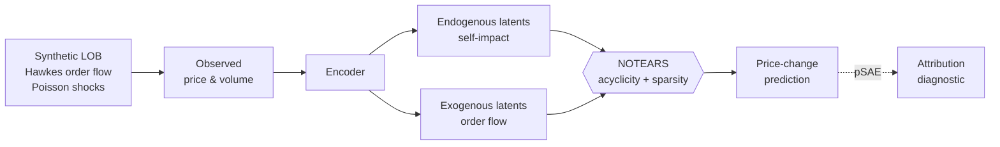

<div align="center">

# Siddhardha Devarakonda

### Causal Decision-Making · Offline RL · Multi-Agent Systems · Quantitative Markets

*Building agents that make reliable decisions when the data is confounded, non-stationary, and only partly observed.*


[LinkedIn](https://www.linkedin.com/in/siddhardhadeverakonda) · [Email](mailto:siddhardhdevarakonda17@gmail.com) · [GitHub](https://github.com/siddhardhad17)

</div>


## At a glance

| | |
|---|---|
| **Degree** | B.Tech, Computer Science & Systems Engineering · Andhra University · CGPA 8.33/10 · April 2026 |
| **Focus** | Causal representation learning, offline RL, world models, multi-agent RL, quant market microstructure |
| **Headline results** | 28.5% RMSE reduction in off-policy evaluation · 8.1% lower structural attribution error in a market-making world model · 0.91 ROC-AUC on a 1.05M-row fraud dataset |
| **Current work** | LatentCausal world models for offline RL · a causally regularized market maker · formally verified off-policy evaluation |

## Research

Three manuscripts in progress, all on causal structure in sequential decision making.

**1. Structural Latent Regularization for World Models** *(2026)*
Offline RL with confounded credit assignment. Proposes **LATENTCAUSAL-WM**, an RSSM-based world model whose latent dynamics split into endogenous and exogenous components, with NOTEARS sparsity and acyclicity constraints on the endogenous part. Introduces **proxy Structural Attribution Error (pSAE)**, a ground-truth-free diagnostic for reward-attribution behaviour under confounding.

**2. Robust Meta-Learning for Fast Adaptation in Heterogeneous Multi-Agent Systems** *(2025)*
A partner-aware meta-learning framework that conditions policy adaptation on latent behavioural embeddings, so agents coordinate with previously unseen partners. A unified meta-objective covers domain randomization, adversarial perturbations, proximal regularization and communication constraints under distribution shift.

**3. Leveraging Generative AI for Medical Image Processing** *(2024, survey)*
Covers generative-AI methods for medical image generation, enhancement, segmentation and disease detection across radiology, cardiology and pulmonology.

## Flagship projects

### 📈 LATENTCAUSAL-MM — Causally-Regularized Market Maker
*Causal world models · Market microstructure · Limit order books*

A synthetic limit-order-book environment with a known ground-truth decomposition of price movement into **endogenous** (self-impact) and **exogenous** (Hawkes-process order flow, Poisson-timed shocks) components. A causal world model with structurally partitioned latents has to recover that decomposition from observed data alone.

- Benchmarked against a naive single-latent attribution baseline on 15,000 held-out steps
- Reduced **proxy Structural Attribution Error by 8.1%** (0.0277 → 0.0254)
- Reduced total price-change MSE by **8.5%**



### 🧮 VerifiedOPE — Type-Safe Off-Policy Evaluation in OCaml
*OCaml · Type theory · Causal inference*

A GADT-based estimator framework where each off-policy estimator's type signature enforces its required artifacts at compile time. For example, doubly-robust estimation cannot be instantiated without both a target policy and a fitted reward model. Verified through native compilation with `ocamlopt`.

- Importance sampling and doubly-robust estimators, checked against a Monte Carlo ground-truth policy value (2M samples)
- Evaluated over 200 trials on synthetic contextual-bandit data
- Reduced doubly-robust RMSE by **28.5%** (0.0093 → 0.0067) versus importance-sampling-based estimation

### 🔁 Independent Reproduction of Structurally Regularized World Models
*Research reproduction · Offline RL · Causal representation learning*

A controlled causal environment with known confounders, endogenous/exogenous variables and a documented DAG, built to test latent structural separation under confounding and distribution shift. Implements an RSSM with endogenous/exogenous latent partitioning and NOTEARS-based acyclicity regularization, evaluated on structural attribution, policy-value estimation, latent alignment and distribution-shift robustness.

### 🧪 Confounded Offline Policy Evaluation
*Causal inference · Offline RL*

A confounded-MDP benchmark with hidden confounders, observable treatment and outcome proxies, behaviour and evaluation policies, and simulator-derived ground-truth policy values. Compares weighted importance sampling, direct estimation, structural regularization and proximal causal inference across confounding strength, proxy quality and sample size.

### 🚦 Multi-Agent RL for Traffic Signal Control
*MARL · Sequential decision making*

MADDPG with decentralized actors, centralized critics, adaptive exploration, gradient clipping and soft target updates, applied to traffic-signal control under non-stationary multi-agent dynamics. Includes a configurable simulator with vehicles, pedestrians and **emergency-vehicle pre-emption**, benchmarked on reward, queue length, throughput and training stability against fixed-time control.

```text
 ┌──────────┐   obs_i    ┌────────────┐
 │ Junction │──────────▶ │ Actor_i    │──▶ phase_i
 │    i     │            └────────────┘
 └──────────┘                  ▲
      ▲          ┌─────────────┴────────┐
      │          │ Centralized Critic   │ (training only)
      └──────────┴──────────────────────┘
```

### 🛡️ WebScanPro — AI-Assisted Vulnerability Scanner
Python and Selenium automation packaged with Docker, using LLM-assisted vulnerability classification and automated reporting.

### 📉 Self-Supervised Log Anomaly Detection
Representation learning over distributed-system logs, with reconstruction-error modelling to flag anomalies without labels.

### ⚙️ Cloud Resource Optimization
An intelligent auto-scaling framework for dynamic workloads.

### 🏥 Fraud Detection (research internship, NIT Andhra Pradesh, 2024)
Preprocessing and feature-engineering pipeline on a **1.05M-row transaction dataset**, yielding 533,901 unique transactions and identifying 235 fraud cases (0.044%) under severe class imbalance. Random Forest with a 30% holdout reached **0.91 ROC-AUC**, with feature-importance analysis and benchmarked alternative configurations.

## Stack

| Area | Tools |
|---|---|
| **Languages** | Python · OCaml · C++ · C · Java · SQL · Bash · JavaScript |
| **ML / RL** | PyTorch · TensorFlow · scikit-learn · NumPy · pandas |
| **Research methods** | MARL · Offline RL · Meta-RL · World models (RSSM) · Causal inference · Off-policy evaluation · NOTEARS · Proximal causal inference · Difference-in-Differences · Propensity-score weighting |
| **Formal methods** | GADTs · Property-based testing (QCheck) · DAG constraints |
| **Quant finance** | Market microstructure · Limit-order-book simulation · Hawkes processes · Market making · Cointegration (Engle–Granger / Johansen) |
| **Systems** | Event-driven simulation · Low-latency systems · Deterministic simulation · Linux · Docker · Git · PostgreSQL · Redis |
| **Maths & CS** | Linear algebra · Probability · Statistics · Optimization · Algorithms · Data structures |

## Currently exploring

- Robust and causal reinforcement learning
- Bayesian deep learning and uncertainty-aware world models
- Causally regularized market making and order-flow modelling
- Type-safe, verified causal estimators

## Roadmap

- [ ] Submit the offline-RL world-model manuscript
- [ ] Open-source the LATENTCAUSAL-MM environment with reproducible benchmark scripts
- [ ] Extend VerifiedOPE to additional estimators (proximal, instrumental-variable)
- [ ] Add continuous-integration tests for the simulators

## Open to collaborate

Causal machine learning · offline and multi-agent RL · quantitative research and market microstructure · formally verified ML · open-source AI · research collaborations

## Connect

- LinkedIn: [linkedin.com/in/siddhardhadeverakonda](https://www.linkedin.com/in/siddhardhadeverakonda)
- GitHub: [github.com/siddhardhad17](https://github.com/siddhardhad17)
- Email: siddhardhdevarakonda17@gmail.com

---

<div align="center">

*Reliable decisions under uncertainty, one causal assumption at a time.*

</div>
